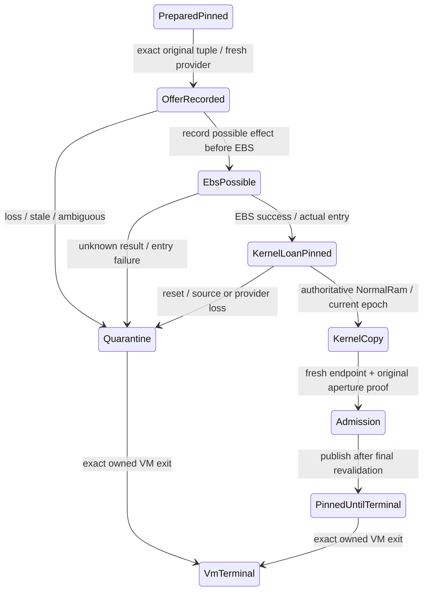

# N1: target assessment и bounded handoff ABI draft, 26.10.2026

**N1 design разрешён; ABI ниже — draft, не implemented/не runtime admission.**
Build/restore/VM, EBS и RuntimeKernel execution не запускались. Original boot/
runtime source не менялся. [Scope decision](SNO-01-STARTUP-DECISION-RU.md).

## Target decision по actual support

Выбран target contract: x86-64 freestanding kernel receiver, загруженный existing
test EFI, после успешного EBS, с собственными paging/stack/runtime/heap services.
Intended managed consumer остаётся existing HybridBootRuntimeHandoff.Create →
Import → HybridBootAuthorityAdmission.RevalidateWithAuthorityOwner. Это цель для
startup producer, не новый C/model importer вместо runtime.

**Поддерживаемого executable target для этого contract в текущем tree не найдено.**
Existing MSVC builder умеет freestanding C EFI application (/nodefaultlib,
/subsystem:efi_application,/entry:EfiMain). Это подтверждённый loader/lab substrate,
но не реализация managed runtime. NativeAotToolchain.ps1 публикует `-r win-x64`,
требует kernel32/ntdll/ucrt и прочие Windows libraries. SingPlus.Boot —
User/ManagedGc, Host HAL/platform. KernelNoHeap class library Boot.Capsule имеет
Run Unsupported, не runtime startup. Поиск runtime exports/инициализации в relevant
src/Kernel и SingPlus.Runtime не выявил freestanding bootstrap/GC/PAL target.
SingPlus.Kernel.Sdk содержит contracts/attribute, не native linker/runtime target;
Kernel.csproj задаёт admission root/profile, но не freestanding entry backend.

Связанный ISE также проверен read-only: [NativeAot Adapter project](<../../../../HybridCPU ISE/Compilers/HybridCPU_Compiler/NativeAot/HybridCPU.Compiler.NativeAot.Adapter.csproj>)
и [SDK targets](<../../../../HybridCPU ISE/Compilers/HybridCPU_Compiler/NativeAot/Packaging/HybridCPU.Sdk.targets>).
SDK target RID `hybridcpu` публикует `.hcexe` с explicit restricted compiler profile
и runtime pack; `SupportedHostRids=[win-x64]` описывает **host compiler RID**, не
архитектуру emitted guest image. Ни host RID, ни HybridCPU ISA image не являются
x86-64 freestanding .NET kernel substrate. ISE arch/core/ISA не менялись;
compile/publish этого pipeline не запускался. Это дополнительный source assessment,
не отказ компилятора и не qualification всего ISE tree.

Следствие: target/backend **ExternalBlocked / native runtime substrate Missing**.
Нельзя выбрать Windows PE, переименовать subsystem и считать его EFI/kernel.
Нельзя заменить receiver C fixture, host-debug process, QMP memory copy или model
provider. Linux/WSL/firmware install и новый собственный runtime port не разрешены.
Первый implementation gate — конкретный поддерживаемый guest toolchain/runtime
artifact и его original startup owner; N1 не обещает, что такой artifact уже есть.

[Native AOT docs](https://learn.microsoft.com/en-us/dotnet/core/deploying/native-aot/)
описывают OS-specific target environment; local script подтверждает выбранный
Windows RID. Это source/toolchain assessment, не новый compile/failure result.

## Draft entry и memory contract

Для совместимости с existing MSVC x64 выбран Microsoft x64 calling convention:
`noreturn KernelEntry(const SNO_HANDOFF_V1 *handoff)`; RCX — identity-mapped physical
address descriptor. Caller обеспечивает shadow space32 bytes и RSP mod16=8 на
callee entry; DF=0. IF=0, kernel-owned stack/GDT/IDT/page tables обязательны.
Возврат запрещён: terminal failure, без обращения к EFI. Это proposed guest ABI,
не Windows execution environment. [Calling convention](https://learn.microsoft.com/en-us/cpp/build/x64-calling-convention?view=msvc-170).

BSP entry требует доказанного handoff остальных трёх vCPU: native-owned parking
code/stacks и absence of outstanding firmware/device callbacks. Не предполагать,
что firmware AP loop остаётся пригодным после EBS. AP/interrupt/bootstrap proof
Missing входит в startup substrate gate; 4-vCPU profile не менять ради обхода.

Descriptor: little-endian, 8-byte aligned, size160, magic0x314f4e53 (`SNO1`),
version1. Unknown version/size/flags/reserved deny. Это bounded **metadata**, не
authority token и не дубликат HBI1. Все ranges проверяются overflow-safe до reads.

| Offset | Поле / constraint |
|---|---|
| 0 | u32 Magic; u16 Version; u16 Bytes=160 |
| 8 | u64 Flags=0 |
| 16 / 24 | u64 BootInfoPhysical / BootInfoBytes: exact actual HBI1 tuple, bounded existing BootAbiV1 limit, aligned8 |
| 32 / 40 / 48 | u64 KernelImageBase / ImageBytes / ExecutableEntry: entry внутри verified executable image, W^X, bounds independent of BootInfo |
| 56 / 64 | u64 BootstrapStackBase / Bytes: separate owned NormalRam, bounded explicit allocation; includes shadow/trap path |
| 72 / 80 | u64 FinalMemoryMapPhysical / Bytes: immutable copied final UEFI map, max64KiB |
| 88 / 92 | u32 UefiDescriptorBytes / Version: actual GetMemoryMap values, validate stride/count/length; no assumed fixed firmware layout |
| 96 / 104 | u64 RetainedRangesPhysical / Bytes: max256 records ×32 bytes |
| 112 | u64 OriginalHandoffOperation: correlation only, no permission/epoch minted |
| 120..159 | Reserved40 bytes=0 |

Retained record32 bytes: u64 base/length, u32 kind/flags, u64 reserved0. Proposed
kind1 Image,2 Bootstrap,3 DescriptorAndMaps,4 PayloadAndBootInfo,5 NativeOwnerPins,
6 PlatformTables; no unknown kind/flags, no overlap except explicitly same full
allocation descriptor (prefer single record per allocation). Whole-range geometry
must agree with original allocated tuple, copied final map and kernel image owner.
Physical addresses/UEFI memory types alone do not authorize access.

Final map is firmware evidence. KernelMemoryOwner constructs authoritative kernel
classification from trusted bootstrap + validated original allocations/final map;
implements IKernelBootMemoryMap/IKernelPhysicalMemory/IKernelBootCopyEpoch. Payload/
BootInfo is NormalRam under immutable retained read loan, excluded from allocator,
not mislabelled firmware/MMIO/reserved. Image overlap always denied. Descriptor
does not supply a trusted copy epoch: kernel lifecycle owner supplies/checks it.
Map/descriptor/Bootstrap/Image do not alias BootInfo; target image RX/data RW-NX.

## Original ownership и state transitions

Existing NativePreparationOwner остаётся original allocation owner. External A
supervisor хранит original obligations вне firmware image и binds exact VM,
endpoint, reset/isolation/mapping domains. Kernel получает immutable read loan,
создаёт собственную NormalRam copy; original pages **никогда не free/reuse** в
первом bounded design, даже после successful copy/import. Они удерживаются до
exact whole-VM terminal. Kernel allocator обязан исключить все retained ranges.
Kernel-owned copy имеет отдельный kernel lifetime; source pointer не становится
kernel capability и никогда не читается после reset/provider loss.

Offer/LoanAccepted должны расширять existing A channel, не второй owner. Signed
reply binds exact original allocation/ranges/operation/current domains; pointer,
nonce, printed INFO, counter, ACK или readback сами не grant. До kernel publication
mandatory revalidation; lost acceptance не даёт loader clear/free. Состояние
original retained loan остаётся у external owner до terminal, не в reset firmware
record. ABI wire fields для этого channel нельзя invent поверх existing V3 без
отдельного implementation review и protocol compatibility negatives.

До EBS failure с доказанным отсутствием handoff возможен только original cleanup
через existing owner. С первого EBS attempt callback/console/allocator discipline
должна следовать UEFI contract; stale MapKey требует documented bounded retry,
не произвольный EFI recovery path. После success EFI Boot Services, console и
Stall/FreePages запрещены. Existing lab Abort смешивает console/Stall с runtime
ResetSystem, поэтому целиком не переиспользуется после EBS; proposed failure path
идёт к external whole-VM termination, без return-to-Shell. Runtime Services не
объявляются запрещёнными самой UEFI, но этот draft не полагается на них для cleanup.
Финальный map buffer заранее выделен;
no intervening allocation between final map acquisition and EBS call.
[UEFI Boot Services/EBS](https://uefi.org/specs/UEFI/2.11/07_Services_Boot_Services.html).

## Provider / publication gate

Fresh managed discovery и IHybridCpuBootHardware должны принадлежать guest
platform integration owner и обращаться к effect-backed current A producer;
CxlType3ModelProvider/host refs не substitutes. Per-VM pin provisioning, native
post-EBS COM2 transport, currentness checks и failure containment требуют real
guest implementations. Existing IFirmwareBootApertureOwner получает original
operation, не реконструирует её из BootInfo. Generation domains не сливаются.

**Ещё один independent blocker положительного admission:** current native local
decoder retire не доказывает CpuRouteClosed/DmaAndOtherEffectsClosed. До real
original aperture proof IFirmwareBootApertureOwner возвращает quarantine; existing
HybridBootAuthorityAdmission тогда обязана deny. Persistent source pins безопасны,
но сами не превращают quarantine в Released. Kernel mapping removal/UEFI type/
VT-d readback не заменяют proof. Native entry reached/importer refusal — полезный
future negative, но не closure полной цели.

## Minimal file-level diff после отдельного implementation решения

| Proposed area | Связная delta / prerequisite |
|---|---|
| tools/SingNext.CxlLab/efi/NativePreparationOwner.{c,h}, RamStage.c | Explicit retained read-loan transition вместо observer clear/free только в новом opt-in startup mode; original default lab без delta |
| Same test EFI composition + new startup-only C/ASM/header units | Frozen map/descriptor, verified actual guest image load, owned BSP/AP/stack/paging/entry; EBS path требует explicit authorization |
| tools/qemu-cxl/Build-CxlEfiReader.ps1 | Isolated opt-in startup target inputs/verified artifact hashes; no production BOOTX64.EFI or firmware replacement |
| Tools/CxlLifecycleLab | Existing A producer retains original handoff obligations/currentness; terminal completion, no original post-reset reads/reclaim |
| Guest native runtime bootstrap (currently Missing) | Real runtime/PAL/GC/heap/physical-memory target; exact supported source/artifact first, no fictitious csproj that emits Windows host binary |
| Guest platform/kernel adapters (new isolated composition) | Concrete three kernel memory interfaces + fresh enumeration/discovery/isolation/aperture owner, existing contracts reused |
| Existing HybridBootProductionAdapters / HybridBootAuthorityAdmission | New actual startup composition calls existing consumers; no duplicated importer/parser or success bypass |

No original BootCapsuleEntry.Run/SingBoot/DirectBootCapsule/RuntimeKernel edit
proposed as an immediate executable step. Exact bootstrap file list cannot honestly
be finalized until a real runtime target exists; that row remains ExternalBlocked,
not a helper implementation milestone. Broad runtime/package graph verification
required if a later approved implementation changes shared runtime source.

## Acceptance / implementation gates

1. Supported freestanding artifact with imports/runtime dependencies audited and
   actual guest startup demonstrated; C stub alone не qualifies managed consumer.
2. Original retained tuple remains intact across handoff/EBS/copy; kernel source
   read/write rights distinct; allocator cannot reuse source/image/stack/table pins.
3. Actual descriptor/HBI1 physical tuple → kernel-owned copy → existing Import →
   authority revalidation; positive only with fresh provider + proved aperture.
4. Negative descriptor version/flags/overflow/range/map-stride/image overlap,
   duplicate retained ranges, wrong VM/operation/session/address, provider/domain
   change, stale copy epoch, quarantine и unknown outcome до effect/publication.
5. Actual reset/loss/partial windows around offer/EBS/entry/kernel copy/admission;
   no old original read/free/reuse, independent peer unaffected, terminal exact VM.
6. No post-EBS Boot Services use; wrong MapKey/failed EBS/returned entry/AP failure
   retain obligations and cannot silently return to Shell or mark startup success.

N1 **design completed, implementation blocked** by native runtime substrate,
guest kernel/platform owners, original aperture proof and separate execution/EBS
authorization. N1 не выбирает production trust/provider: SNO-03 independent
provisioning/durable monotonic storage остаётся отдельным Missing/scope blocker.
SNO-02 Partial, SNO-01/QCXL-04/05/06 ExternalBlocked; SNO-04/QCXL-08/09 implementation
FutureGated. Это specification/assessment, не новый behavioral или ProductionQualified pass.

26.10 пользователь подтвердил отсутствие existing freestanding x86-64 guest runtime/PAL/bootstrap вне проверенных local paths. Implementation требует real artifact/owner либо нового отдельно разрешённого runtime-substrate scope; N1 design не разрешает runtime port или execution.
