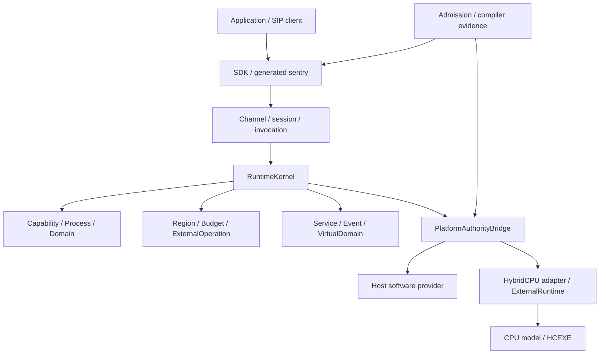

# Архитектура и authority

SingNextOS в данной кодовой базе — комплекс managed contracts, admission tooling, SIP клиентов, runtime authorities и platform adapters. RuntimeKernel собирает отдельные owners и координирует их вызовы. Kernel entry/HAL и boot-проекты образуют отдельный слой входа. Executing contour доступен через .NET host → external provider → CPU model → compiler-produced guest HCEXE; это не перенос всей ОС в hybridcpu-v2 binary.

Стрелка означает dependency/call flow, а не передачу authority. Admission = SingNext authorization AND provider admission AND semantic refinement AND current legality. Все четыре условия независимы. Mandatory unknown deny; downgrade требует fresh admission.

## Compilation boundaries

SingPlus.Contracts задаёт shared vocabulary; SIP SDK/generators формируют клиентский contract surface. Runtime зависит от Contracts, Platform.Abstractions, SIP, Boot.Contracts и external contracts package. Platform.Host и Platform.HybridCpu реализуют platform interfaces. StaticAdmission компилирует selected Admission tools source с единым compilation owner. Наличие проекта не доказывает его работу в bare-metal image.

V1/staged остаётся существующим совместимым контуром. Новые interfaces и sidecars additive до доказанной breaking need. Optional provider interface требует actual producing client; DTO/parser/helper сам не producer.

## Единственный owner каждого факта

| Logical fact | Owner | Недопустимая замена |
|---|---|---|
| Permission | CapabilityAuthority | Receipt, attestation, proof |
| Process incarnation | ProcessRegistry | PID или entry name |
| Runtime domain registration | DomainRegistry | Provider topology |
| Virtual lineage/local mapping | VirtualDomainAuthority | VMCS/topology metadata |
| Region ownership/use/damage/backing | RegionAuthority | VA/IOVA/mapping |
| Operation lifecycle | ExternalOperationAuthority | Provider correlation |
| Quantitative truth | ResourceBudgetAuthority | Scheduler/telemetry |
| Event/waiter lifetime | KernelEventRegistry | Completion notification |
| Session/invocation/publication | Existing corresponding registries | Transport reply |
| Sealed object lifetime | SealedObjectAuthority | Ciphertext/measurement |
| Provider admission/closure | Concrete provider | OS permission |
| Machine legality/replay | HybridCPU machinery | Compiler proof/OS trace |

Handle continuity требует relevant realm, incarnation, generation, source epoch и canonical owner. Equal tuple, copied object, ABA и returned wrapper не continuity. Bridge receipt является correlation, не вторым ledger.

## Cross-owner discipline

Prepare immutable intent → retain original facts → narrow pin/admission → fresh mutable checks → mark possible effect → provider call вне unrelated owner locks → retain raw → fresh checks → final publication/consumption → independent closure/reclaim. Callbacks, notifications, observations и trace вне commit locks. После callback проверяется fresh source/owner state. Throw/reentry не теряет original и не повторяет unknown effect.

## Источники

- [RuntimeKernel](../../../src/Runtime/SingPlus.Runtime/RuntimeKernel.cs)
- [Runtime project](../../../src/Runtime/SingPlus.Runtime/SingPlus.Runtime.csproj)
- [Owner map](../../SingNextOS-v6-roadmap-reworked-2026-09-23/02-AUTHORITY-OWNER-MAP.md)
- [Normative invariants](../../SingNextOS-v6-roadmap-reworked-2026-09-23/04-NORMATIVE-INVARIANTS.md)
