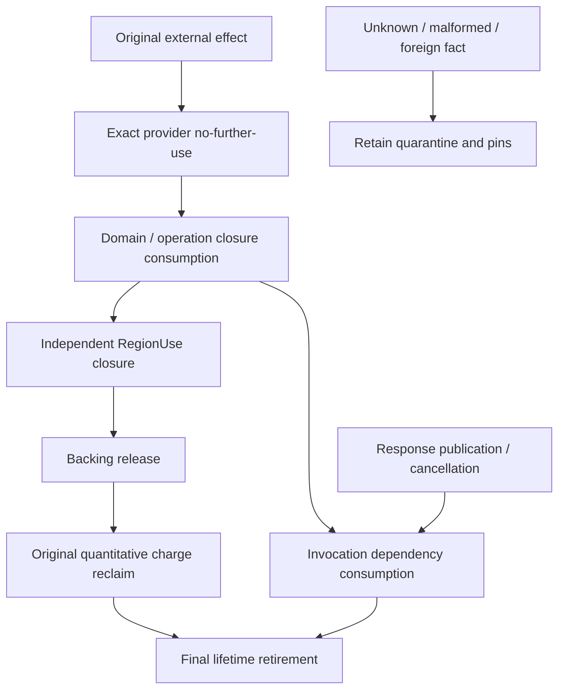

# Матрица подсистем и архитектурные границы

## Связи и ответственность

| Subsystem/source area | Вход / dependencies | Собственный факт или роль | Выход / потребитель |
|---|---|---|---|
| Contracts | Versioned vocabulary | DTO/semantic clauses, не authority | SDK/runtime/platform/tools |
| SDK/System | Application compilation | API/profile surface | SIP/kernel consumers |
| Analyzers/Generators | Source/contracts | Diagnostics/generated protocol | Admission и runtime sentry |
| StaticAdmission | IL/PE/frontend inputs | Static validation/evidence | Admission tools/runtime |
| Boot/HAL | Loader/host evidence | Entry/handoff/platform console | Kernel/runtime admission |
| Processes | Manifest/control capability | Incarnation/terminal state | Все caller-bound operations |
| Capabilities | Principal/derivation/policy | Permission/revocation | Runtime admission |
| Domains | Registration/process identity | Runtime domain membership | Process/service isolation paths |
| Components | Manifest/resources | Component admission composition | Driver/service hosts |
| Regions | Original allocation/acquisition | Ownership/use/damage/backing | IPC/DMA/guest/compute |
| Budgets | Resource dimensions/original leases | Quantitative reserve/bind/consume | Admission/settle/reclaim |
| Channels | Capability/session/message | Enqueue/accepted envelope/channel | SIP/service dispatch |
| Services | Channel/endpoint/process | Service/session/invocation lifetime | Actual hosts/response publication |
| NativeServices | Admitted service/session | Host drain/custody | Teardown/response reconciliation |
| ExternalOperations | Authorized request/resources | Prepare/submit/terminal/quarantine | Provider and final settlement |
| Platform bridge | Exact owners/provider source | Correlation/adaptation/interlock | Provider APIs/local cleanup |
| Host provider | Original branded requests | Software/model acceptance/closure | Bridge canonical resolution |
| HybridCPU provider | ExternalRuntime/dependencies | Executable adapter projection | CPU model/guest effects |
| Drivers | Device manifest/MMIO/DMA/IRQ | Driver-specific orchestration | Device operations/events |
| Events | Provider/local delivery | Event/waiter lifetime | Waiters/service client |
| Deadlines | TimeProvider/cancellation scopes | Local cancellation lifecycle | Dispatch/operation cancellation |
| Compute | Plan/resources/context | Planner/host integration | DSC1/external execution |
| Virtualization | Parent/domain/capability | Local lineage/mapping/terminal | Child/nested/artifact execution |
| Virtual-I/O | Original bind/transfer/backing | VIO correlated lifetime | Provider transfer/close |
| SecureCompute | Secure policy/evidence | Secure-domain contract/lifetime | Protected executing contour |
| CXL | Topology/device/evidence | Local memory/fabric/security tracking | Placement/accelerator/retention |
| SipJobs | Verified DAG/stage/resources | Job plan/eligibility/orchestration | Actual stage execution |
| GUI | Session/Region payload | Compositor service orchestration | IPC publication/transfer |
| VNext | Resource/semantic contracts | Migration/scheduler integration | Fresh admitted execution |
| V6 | Applicable phase contracts | Bounded semantics/models/adapters | Named consumers/claim evidence |
| Checkpointing | Local process/Region snapshot | Checkpoint operations | Local restoration paths |
| Tracing | Runtime observations/time | Deterministic trace/replay | Diagnostics/evidence |
| Observability | Read authoritative state | Inspection/blocker explanation | Operator/tests, не commit authority |
| Qualification tools | Exact inputs/deployment | Evidence collection/checking | Named claim qualification |

Таблица описывает ответственность, не уровень готовности. Каждый source surface доступен в [атласе](09-SOURCE-ATLAS.md); конкретный actual producer устанавливается по callers, а не имени директории.

## Closure graph

Граф — dependency illustration. Он не вводит universal transaction или единый обязательный порядок всех implementation commits: actual owner contract определяет порядок конкретного consumer. Response completion не является ребром прямо к backing release. Independent users могут удерживать use/backing/charge после provider closure одного original.

## Trust boundaries и threat cases

Недоверенные payload/parser input не получают capability по форме DTO. Copied branded request/raw, equal tuple и foreign owner route должны denied continuity. Source replacement/incarnation drift и revision/generation exhaustion проверяются до effect/final commit. Reentry/overlap не создают второй effect. Loss после effect не разрешает repeat; отсутствие history не no-effect. Partial local retirement допускает cleanup-only continuation same original, без permission resurrection.

Protected execution требует своего producer, authenticated evidence/freshness и runtime policy. Physical DMA/reset/coherence/remote isolation не выводятся из model behavior. Cold replay требует отдельного trusted anchor. Это открытые architectural prerequisites, а не запрет независимой managed implementation.

## Deployment contours

Host software/model, HybridCPU external model/adapter, compiler-produced guest и physical deployment — разные contours. Общее contract vocabulary позволяет интеграцию, но не переносит автоматически claims между ними. .NET host lifetime, guest terminal lifetime и machine legality имеют отдельные owners. Qualification требует exact deployment tuple; green тестовый graph не blanket production OS claim.
