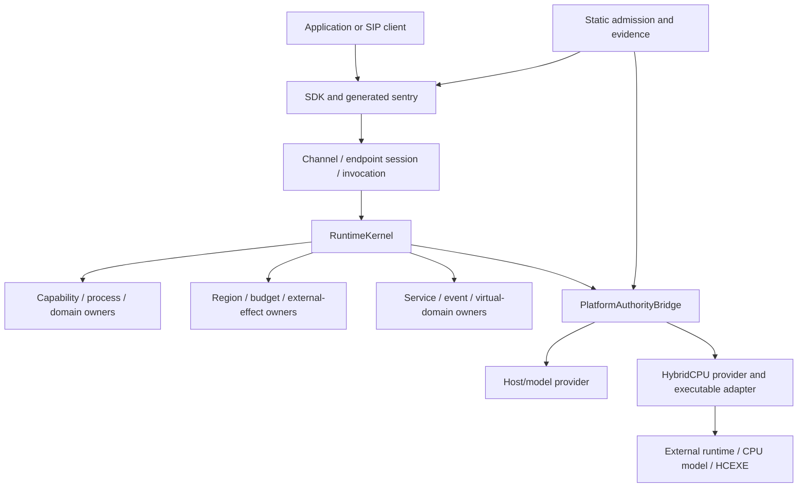

# Architecture and authoritative ownership

## Operating-system identity

SingNextOS is implemented as managed contracts, static admission, SIP-facing clients and hosts, runtime owners, and narrow platform adapters. The [`RuntimeKernel` constructor](../../../src/Runtime/SingPlus.Runtime/RuntimeKernel.cs) creates separate `ProcessRegistry`, `DomainRegistry`, `CapabilityAuthority`, `SealedObjectAuthority`, `RegionAuthority`, `ExternalOperationAuthority`, `ComputePlanner`, `ChannelRegistry`, `PlatformAuthorityBridge`, `ServiceRegistry`, `EndpointSessionRegistry`, `CancellationScopeAuthority`, `ResourceBudgetAuthority`, and `DeterministicTraceAuthority`.

This is a compositional managed runtime, **not** evidence that every service executes in a physically isolated address space or that the whole OS has been transplanted into a HybridCPU binary.



Arrows represent calls and dependencies, **not transfer of authoritative ownership**.

## Compositional admission

The conceptual predicate for an externally effectful resource operation is:

```text
live semantic effect permission
AND admissible resource use and memory ownership
AND live quantitative budget / applicable reservation
AND exact process, session, invocation and source generations
AND provider acceptance
AND applicable semantic refinement
AND current runtime / machine legality
AND qualified feature contour where required
```

The exact terms depend on the operation. A receipt, compiler proof, topology map, attestation, reservation, or trace cannot unilaterally satisfy the entire predicate. Unknown mandatory inputs deny admission; provider downgrade requires fresh checks.

## Single-owner truth

| Logical fact | Canonical owner | Not a substitute |
| --- | --- | --- |
| Semantic permission and revocation | `CapabilityAuthority` | certificate / provider response |
| Process incarnation and terminal state | `ProcessRegistry` | reused PID / entry name |
| Domain membership | `DomainRegistry` | topology |
| Virtual lineage and local mapping | `VirtualDomainAuthority` | VM metadata |
| Region ownership, use, damage, backing | `RegionAuthority` | address / IOVA / map |
| Quantitative reservation and charge | `ResourceBudgetAuthority` | scheduler / counters |
| Exact external operation lifecycle | `ExternalOperationAuthority` | provider correlation ID |
| Accepted channels, sessions and invocations | corresponding registries | transport response |
| Events and local waiters | `KernelEventRegistry` | IRQ delivery |
| Sealed object liveness | `SealedObjectAuthority` | ciphertext |
| Provider admission and no-further-use | exact provider | local permission |
| HybridCPU machine legality and retire | runtime/machine mechanisms | OS trace |

Relevant files: [capabilities](../../../src/Runtime/SingPlus.Runtime/Capabilities/CapabilityAuthority.cs), [regions](../../../src/Runtime/SingPlus.Runtime/Regions/RegionAuthority.cs), [budgets](../../../src/Runtime/SingPlus.Runtime/Budgets/ResourceBudgetAuthority.cs), [external effects](../../../src/Runtime/SingPlus.Runtime/ExternalOperations/ExternalOperationAuthority.cs).

## Identity and temporal continuity

A handle must be related to its live owner/realm, generation, incarnation, source epoch and original fact. Equal-valued tuples, deserialized copies and reused numeric IDs cannot establish continuity. Authorization is revalidated at effect and final publication boundaries, especially after callbacks, source replacement, a failure, or re-entry.

## Cross-owner discipline

Typical path (not a universal atomic transaction):

1. Prepare immutable intent and retain exact accepted originals.
2. Acquire narrow use pins/reservations; check owner/source generations.
3. Verify provider acceptance, refinement and legality.
4. Record possible effect **before** an irreversible call.
5. Invoke outside unrelated owner locks, once per original.
6. Retain canonical observations; revalidate mutable facts.
7. Commit response/publication with the rightful owner.
8. Consume exact closure; independently release users, backing and charges.

Completion, visibility, publication, consumption and reclamation are separate commits. No callback, observer, or trace recorder may replace authoritative state. See [lifecycle details](05-LIFECYCLES.md) and [closure matrix](11-SUBSYSTEM-MATRIX.md).

## Compilation and package boundaries

Shared vocabulary lives in [`SingPlus.Contracts`](../../../contracts/SingPlus.Contracts/SingPlus.Contracts.csproj). SIP clients and generated sentries are separate from `Runtime`; providers implement [platform abstractions](../../../src/Platform/SingPlus.Platform.Abstractions/SingPlus.Platform.Abstractions.csproj). Current `Runtime` references `HybridCPU.ExternalRuntime.Contracts` version `[1.36.4]`, rather than an arbitrary locally edited sibling source. Proof metadata never replaces present-tense source and owner checks.
