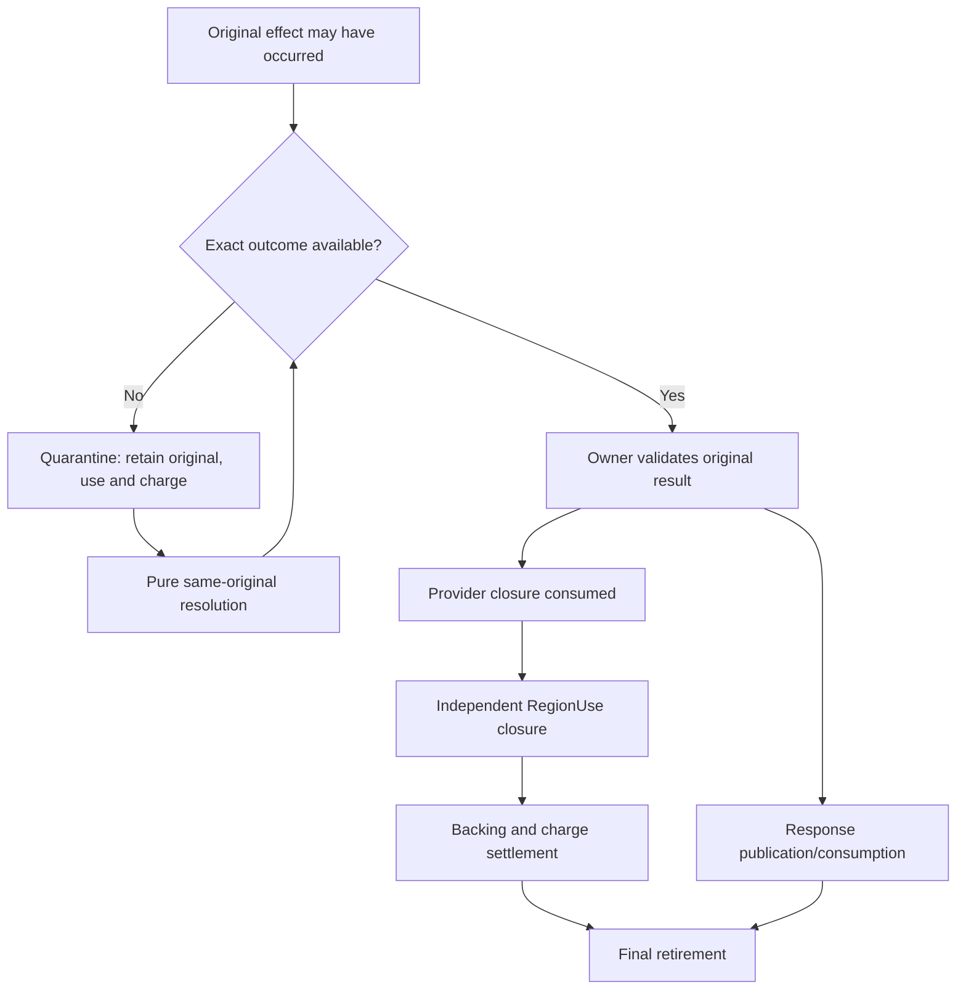

# Lifecycles, partial failure and recovery

## One accepted external effect

1. Verify caller process, live capability, domain, exact session and all relevant generations.
2. Retain an accepted original invocation/input/resource request *before possible effect*.
3. Obtain provider acceptance and applicable semantic/refinement/legality checks.
4. Mark the operation as possibly effectful; submit only once for that original.
5. Save canonical raw observation before callbacks or other re-entrant operations.
6. Revalidate mutable owner/source state before local composition and response publication.
7. Consume exact original provider no-effect or no-further-use closure independently of publication.
8. Release RegionUse, backing, quantitative charge, and invocation/session pins only after their own obligations have closed.

This is a dependency graph, not one global lock or a promise of universal crash-atomic transactions. See [external-operation owner](../../../src/Runtime/SingPlus.Runtime/ExternalOperations/ExternalOperationAuthority.cs) and [platform bridge](../../../src/Runtime/SingPlus.Runtime/Platform/PlatformAuthorityBridge.cs).

## Outcome distinctions

| Observation | What it proves | What it does **not** prove |
| --- | --- | --- |
| Exact pre-submit local refusal | This local invocation was not submitted | Other external originals are closed |
| Exact provider no-effect | No effect for the *identified* attempt | Generic future safety |
| Completion | A provider completion state was reported | Memory visible, response published, backing reclaimable |
| Publication | A response became locally visible | External no-further-use or settled budgets |
| Cancel request / timeout | Local cancellation intent or elapsed time | Containment of an external effect |
| Unknown, malformed or missing reply | No trustworthy conclusion | Safe retry or release |
| Exact provider no-further-use | Closed specified provider usage | Independent users have closed |
| Warm canonical original lookup | An existing original can be reconciled | Cold rollback-safe global history |

The figure omits provider-specific ordering restrictions; it is intentionally not a universal commit algorithm.

## Failed publication and partial retirement

If an external action has already executed, a failed response publication must not cause the action to execute again. A verified response-only retry may use an existing original. A copied result, tuple-equal wrapper or foreign owner route does not grant compensation/reclaim authority.

Partial retirement may have consumed provider closure while invocation cleanup remains pending. Retry continues unconsumed cleanup steps; it must never re-create consumed facts or reissue the external close. Native service drain prevents new work, not completion of work already in flight.

## Callbacks, source drift and races

Before a provider effect and final commit, check current source epoch, provider incarnation, relevant Region owner and capability generations. Callback re-entry can change routes and revisions; revalidation follows callbacks. Interlocks prevent overlap but are not permission. A throw after submission retains the original and its pins until authoritative resolution.

## Persistence and conservative charge

[`ResourceBudgetRecoveryJournal`](../../../src/Runtime/SingPlus.Runtime/Budgets/ResourceBudgetRecoveryJournal.cs) validates sequence/epoch and authenticated prefixes on replay; [RuntimeKernel](../../../src/Runtime/SingPlus.Runtime/RuntimeKernel.cs) stages the recovered conservative budget charge. In-process prefix checks do not by themselves prevent recovery from an older, separately valid cold image. A trusted monotonic anchor and provider continuation/rollback strategy must be qualified separately.

The [remote lease journaled submit seam](../../../src/Runtime/SingPlus.Runtime/V6/V6ManagedRemoteLeaseJournaledSubmit.cs) records possible submission before delivery; its own summary warns that durability depends on the supplied store and confers no remote authority.

## Testing meaningful failure invariants

Prefer assertions about exact effect counts, canonical/foreign original survival, independent source/destination Region users, backing and budget charges, and precise reclaim vs retention. Raw test totals are evidence only for the specified commit, environment and commands. See [verification](07-VERIFICATION.md).
