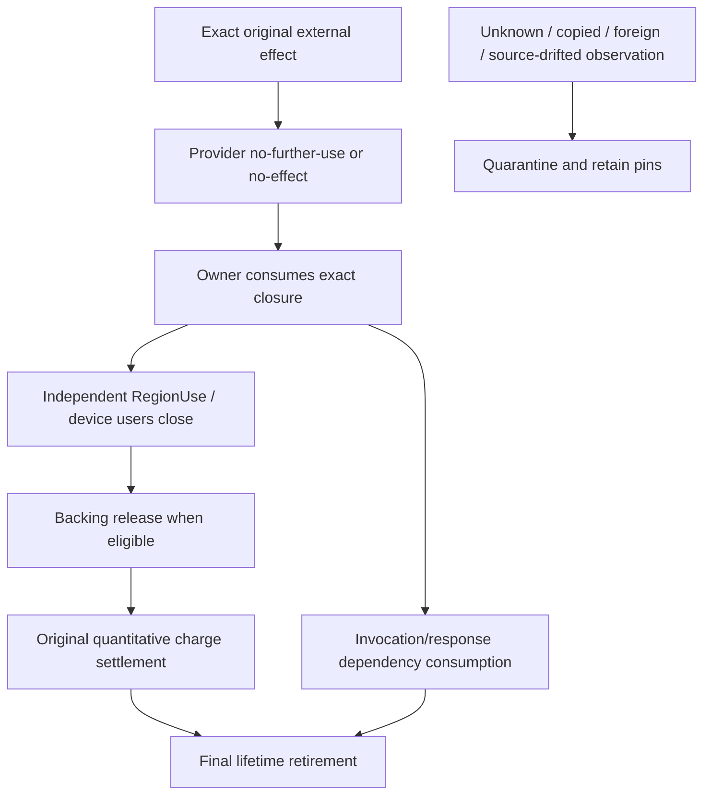

# Subsystem matrix, trust boundaries and resource closure

## Ownership and consumer map

| Component | Owns / does | Consumer or boundary | Must not substitute |
| --- | --- | --- | --- |
| Contracts | Shared versioned vocabulary | SDK, tools, runtime | Live permission |
| SDK/Generators | Source API and generated SIP protocol/sentries | Client compilation | Runtime authorization |
| StaticAdmission | IL/PE/static qualification of identified inputs | Admission tools | Provider legality |
| Boot/HAL | Staged entry, hardware/host evidence, console | Kernel/runtime | Process capabilities |
| ProcessRegistry | Incarnation and terminal routing | Session/operations | Reused PID |
| CapabilityAuthority | Grant/derive/revoke permission | All admitted effects | Budget/region/provider truth |
| DomainRegistry | Runtime membership | Process/service isolation | Provider topology |
| VirtualDomainAuthority | Local lineage and guest domain facts | Virtualization service | Model metadata |
| RegionAuthority | Ownership, use, damage and backing | IPC, DMA, guest | IOVA/map |
| ResourceBudgetAuthority | Quantitative reserve, bind and settle | All charged effects | Scheduler telemetry |
| ChannelRegistry | Accepted channel message and close | SIP transport | Session authority |
| EndpointSession/Invocation | Accepted request, exact response, dependencies | Service host | Provider completion |
| ServiceRegistry/Supervisor | Service lifetime, drain | Native service dispatch | External closure |
| ExternalOperationAuthority | Possible-effect and terminal state | Provider boundary | Arbitrary retries |
| PlatformAuthorityBridge | Source correlation and binding interlock | Provider APIs | New capability/charge ledger |
| Host / HybridCPU providers | Named acceptance and external closure | Adapter/CPU model | SingNext permission |
| KernelEventRegistry | Event/waiter lifetime | IRQ consumers | IRQ delivery alone |
| CancellationScopeAuthority | Local deadline/cancel scope | Invocation | Provider containment |
| Compute/SipJobs | Plans, DAG eligibility, stage admission | Execution hosts | Quantitative reserve |
| Driver paths | DMA, MMIO and IRQ orchestration | Device providers | Region owner |
| GUI/Compositor | Session-based graphical responses | SIP clients | Resource finalization |
| SecureCompute/CXL | Protected/model device/memory contours | Provider evidence | Production isolation |
| V6/VNext | Bounded semantic/model/compatibility paths | Scoped consumers | Automatic gate promotion |
| Checkpointing/Tracing | Local observation and snapshots | Diagnostics | Permission resurrection |
| Observability | Explain retention and blockers | Operators/tests | Reclaim authority |
| Qualification tools | Scoped tests and input evidence | Claim review | Blanket production certificate |

This maps responsibilities and files, not levels of production maturity. See [runtime sources](02-RUNTIME-SUBSYSTEMS.md) and [platform sources](03-PLATFORM-EXECUTION.md).

## Closure dependency model

A completion or response publication has no unconditional edge to freeing backing. Real consumers may require a different local commit order; the diagram is a dependency illustration, not a global transaction.

## Threat cases and safeguards

- **Forgery via DTO:** fields that look like a token do not become a live capability.
- **ABA/stale handles:** equal numeric IDs without canonical realm/generation/source are not continuity.
- **Foreign provider raw:** a different request or source cannot discharge the original.
- **Late completion:** exact publication and final owner state must be rechecked after callback/re-entry.
- **Unknown effect:** timeout or missing history does not license replay or release.
- **Partial cleanup:** retry remaining owner commits without resurrecting consumed authority.
- **Physical escape:** software model results do not prove DMA isolation, multi-host fences, protected memory or remote reset containment.

## Deployment contours

Host/model, HybridCPU executable adapter, compiler-produced guest, and physical deployment are distinct evidence boundaries. Machine legality, managed runtime process lifetime, guest terminal execution, and resource closure are independently evaluated. Exact package/runtime/deployment tuples matter.

**Code status correction:** [session destroy dispatch](../../../src/Runtime/SingPlus.Runtime/Virtualization/RuntimeVirtualizationServiceHost.cs) already preserves invocation correlation; do not describe this as a missing consumer.
